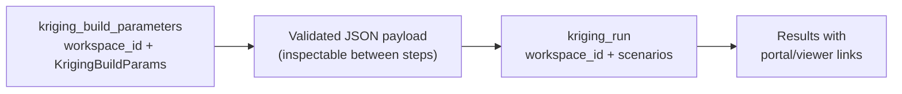

# Compute tools — `tools/compute_tools.py`

Kriging is deliberately **two steps** so the LLM (or user) can inspect and adjust
configuration before execution.



---

## `kriging_build_parameters`

Resolves source, target, and variogram from Evo (parallel), validates inputs,
and produces a round-trippable `KrigingParameters` JSON payload:

```
point_set_object_id + point_set_attribute
variogram_object_id
target_object_id    + target_attribute
neighborhood (ellipsoid + sample/sector/drillhole limits; alias: search)
kriging_method (ordinary | simple; alias: method)
source_filter, target_filter, block_discretization (optional)
```

### Parameter details

- **Canonical names & aliases**: `neighborhood` and `kriging_method` are canonical
  and emitted in built payloads (`search` and `method` remain accepted as input
  aliases unless conflicting values are supplied for both).
- **Ellipsoid**: `neighborhood.ellipsoid` accepts `ellipsoid_ranges` (or `ranges`)
  with positive `major`, `semi_major`, and `minor`, plus `rotation` (`dip_azimuth`,
  `dip`, `pitch`), and serializes `ellipsoid_ranges` and `rotation`.
- **Sample & sector limits**: `max_samples` (`>= 1`), optional `min_samples`
  (`1..max_samples`), and optional octant/quadrant limits (`max_empty_octants`,
  `max_samples_per_octant`, `max_empty_quadrants`, `max_samples_per_quadrant`).
- **Drillhole limits** (require a `DownholeIntervals` source object):
  - `max_samples_per_drillhole` (`>= 1`)
  - `max_drillholes` (`>= 1`; input alias: `max_drillholes_per_estimate`)
  - `min_drillholes` (`>= 0`, omitted when `None` or `0`; input alias:
    `min_drillholes_per_estimate`)
  - `drillhole_limit_scope` (`"global"`, `"quadrant"`, or `"octant"`; omitted
    when `None` or `"global"`, and requires `max_samples_per_drillhole` when
    `"quadrant"` or `"octant"`)
- **Source validation**: `point_set_object_id` supports `PointSet`,
  `DownholeIntervals`, and other point-like spatial objects. Setting any active
  drillhole limit (`max_samples_per_drillhole`, `max_drillholes`,
  `min_drillholes > 0`, or non-global `drillhole_limit_scope`) on a
  non-`DownholeIntervals` source fails fast at build time with a `ValueError`.
- **Strictness**: Unknown fields are rejected at every nesting level.

---

## `kriging_run`

Accepts one or more `KrigingParameters` payloads and runs them in parallel.
Progress is bridged from the SDK's `IFeedback` → FastMCP `ctx.report_progress()`.

Returns per-scenario: target name, attribute created/updated, portal + viewer links.

---

## Why two steps?

- LLM can summarize inputs to the user for confirmation before execution
- Multi-scenario runs: build N payloads, review, then run in one batch
- Separates Evo object resolution (build) from compute submission (run)
